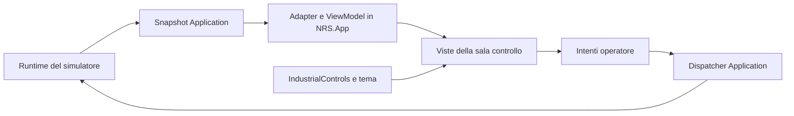

# Integrazione con NuclearReactorSimulator

Verifica del 10 novembre 2026.

IndustrialControls può diventare la base grafica della sala controllo di
NuclearReactorSimulator. La compatibilità di compilazione è verificata; la
sostituzione dei controlli richiede un adattamento delle semantiche di allarmi,
strumenti e comandi prima della migrazione completa.

## Baseline e verifiche eseguite

| Elemento | Baseline verificata |
| --- | --- |
| IndustrialControls | `251d06855286fd79100b147118501de5008cf7d0`, libreria `1.0.0` |
| NuclearReactorSimulator | repository pubblico, commit `11b66caf89efc8b151f90cee66ccad33fce7c437` |
| Framework | entrambi .NET 10 |
| Avalonia | IndustrialControls `12.0.5`; simulatore `12.1.0` |
| Test IndustrialControls | 168 superati, 0 falliti, 0 ignorati |
| Consumer di integrazione | build Release con Avalonia `12.1.0`, contratti Application reali e binding AXAML compilati; 0 errori, 0 avvisi |
| Applicazione del simulatore | build Release della copia con `ProjectReference` alla libreria e `IndustrialControlsTheme` dopo `FluentTheme`; 0 errori, 0 avvisi |

La differenza di versione Avalonia non ha impedito queste compilazioni. Il
consumer di integrazione ha anche eseguito i controlli con assembly Avalonia
`12.1.0.0`. Queste prove non qualificano ancora tutti i template a runtime,
l'avvio grafico, la resa visiva, le prestazioni della sala controllo completa,
il consumo del pacchetto NuGet su Avalonia 12.1 o la suite del simulatore.

Il confronto riguarda la versione pubblica indicata, non eventuali modifiche
presenti in altre copie locali. Le modifiche sperimentali al simulatore sono
confinate alla copia in `artifacts/integration-audit/NuclearReactorSimulator`.

La rilevazione Graphify ha individuato 65 file di codice nella libreria,
circa 19.120 parole. L'estrazione AST è fallita per l'assenza del modulo
`tree_sitter._binding`: non è stato generato un grafo. I rilievi seguenti
derivano dalla lettura dei sorgenti e dalle prove C#.

## Confine architetturale

Il simulatore offre già i contratti necessari:

- `IControlRoomSnapshotSource` pubblica `ControlRoomSnapshot` immutabili;
- `ControlRoomValueSnapshot` trasporta valore numerico nullable, testo, unità,
  qualità, provenienza e metadati della scala;
- `IControlRoomCommandDispatcher` riceve intenti `ControlRoomCommand` tipizzati;
- `MainWindowViewModel` e i controlli `ControlRoom*` costituiscono l'attuale UI;
- `DesktopControlRoomRuntimePump` avanza batch deterministici e pubblica il
  risultato finale; l'host desktop lo invoca ogni 50 ms.

Fonti: [snapshot e comandi][nrs-controlroom], [ViewModel][nrs-vm],
[runtime pump][nrs-pump], [host desktop][nrs-window].

L'adattamento specifico deve vivere nel progetto `NuclearReactorSimulator.App`.
IndustrialControls conserva proprietà e comportamenti generici; nessun riferimento
al motore o ai tipi del simulatore entra nella libreria.



Non serve un protocollo di rete per l'integrazione desktop nello stesso processo.
Sinottici, schemi, selezione dei componenti e computer operatore esistono già nel
simulatore: possono essere composti con i controlli della libreria durante la
migrazione.

## Rilievi prioritari

Le priorità indicano cosa risolvere per la migrazione. Comprendono sia differenze
di contratto sia comportamenti dell'API da correggere o evitare nell'adapter;
non rappresentano fallimenti della suite attuale.

### P1 — Gli allarmi devono riprodurre lo stato del simulatore

`BacklitAlarmIndicator` possiede la memoria `HasLatchedAlarm`, modificabile
soltanto internamente. La imposta sul fronte di attivazione e modifica anche
`IsAcknowledged`. Il simulatore possiede già memoria, riconoscimento, stato
annunciato, sequenza di attivazione e first-out.

La riproduzione C# con un vero `ControlRoomAlarmPresentationSnapshot` ha mostrato:

| Caso | Stato autorevole | Stato del controllo con assegnazione delle proprietà pubbliche |
| --- | --- | --- |
| Nuovo controllo su allarme transitorio già rientrato e memorizzato | `ReturnedUnacknowledged` | `Clear` |
| Reset esterno dopo un transitorio visto dal controllo | normale, senza memoria | la memoria locale resta `ReturnedUnacknowledged` |

Questo riguarda anche riapertura di un workspace, ripristino sessione e replay.
`AlarmAnnunciator` possiede a sua volta una memoria locale e non è una
sostituzione automatica che risolve il problema.

Intervento proposto: modalità generica di presentazione con stato interamente
fornito dall'host, alternativa al comportamento autonomo attuale. Memoria,
riconoscimento e stato visuale devono poter essere applicati come un unico
aggiornamento. ACK e RESET inviano comandi al dispatcher; il controllo si aggiorna
dallo snapshot successivo. First-out e sequenza restano dati del simulatore.

Fonti locali: [memoria e stato dell'indicatore](../src/IndustrialControls.Avalonia/Controls/BacklitAlarmIndicator.cs),
[annunciatore legacy](../src/IndustrialControls.Avalonia/Controls/AlarmAnnunciator.cs).
Fonte consumer: [allarme di presentazione][nrs-alarm].

### P1 — Conservare qualità, provenienza e significato delle scale

`GaugeBase` espone `double Value`, disponibilità e quattro soglie; il contratto
NRS distingue scala di misura, bande operative, banda obiettivo, setpoint e
limiti di protezione. Un mapping unico alle soglie del gauge perderebbe questa
distinzione. Inoltre il quadrante radiale colora di verde l'intervallo centrale
anche quando non sono definite soglie: non va presentato come banda operativa
canonica in assenza di quei dati.

La prova con `ControlRoomValueSnapshot.Unavailable("MPa")` conferma che il solo
fallback `NumericValue ?? 0` produce `GaugeStatus.Normal`. Impostando
`IsAvailable = false` lo stato diventa `Unavailable`; il valore formattato rimane
comunque numerico. Il template va adattato per mostrare `—` o `UNAVAILABLE` senza
offrire uno zero o una posizione dell'ago come misura valida.

Interventi proposti:

- adapter per valore nullable, disponibilità, unità e scala canonica;
- `SignalQualityIndicator` per qualità e provenienza;
- mapping esplicito `Good → Good`, `Suspect → Uncertain`,
  `Unavailable → Unavailable`, senza cast numerici tra enum;
- visualizzazione separata di bande operative, target, setpoint e protezioni;
- conservazione del valore fuori scala, con indicazione esplicita del superamento;
- `ShowOperatingBands = false` sui radiali finché non esiste un mapping fedele.

Fonti: [GaugeBase](../src/IndustrialControls.Avalonia/Controls/GaugeBase.cs),
[bande del quadrante](../src/IndustrialControls.Avalonia/Controls/RadialGaugeDial.cs),
[valore NRS][nrs-value], [scala NRS][nrs-scale].

### P1 — Separare richiesta operatore e risposta dell'impianto

Toggle, selettori e manopole possiedono uno stato interattivo locale. Lo stato
reale può differire per interlock, autorità automatica, ritardo dell'attuatore o
rigetto del comando. NRS distingue già posizione richiesta, posizione effettiva,
modalità manuale e inibizione per le valvole di ammissione.

La prova dell'API `IlluminatedPushButton.TryInvoke()` con `ActionMode = Toggle`
e `ICommand.CanExecute = false` restituisce `true` e imposta `IsLatched = true`,
mentre il comando esegue zero azioni. Il metodo controlla l'interlock ma non
fornisce una conferma di esecuzione del comando. La prova riguarda l'invocazione
programmatica; non dimostra che un click fisico superi il gating di Avalonia.

Interventi proposti:

- usare inizialmente pulsanti momentanei con `ICommand`, disponibilità e interlock
  forniti dal ViewModel;
- alimentare lampade e feedback con proprietà `OneWay` dallo snapshot;
- usare proprietà di richiesta distinte per editing di setpoint e selezioni;
- inviare comandi soltanto a seguito di azioni operatore, senza generare
  comandi durante l'applicazione degli snapshot;
- rendere coerente `TryInvoke()` con disabilitazione e `CanExecute`; trattare
  comunque il suo risultato come accettazione UI, non conferma dell'impianto.

Fonti: [pulsante](../src/IndustrialControls.Avalonia/Controls/IlluminatedPushButton.cs),
[toggle](../src/IndustrialControls.Avalonia/Controls/IndustrialBistableSwitchBehavior.cs),
[valvole NRS][nrs-admission].

### P2 — Tempo dei trend e ciclo di vita della sessione

`TimeSeriesControlBase` usa secondi forniti dall'host e non gestisce la sessione.
Inserendo campioni a `t=100` e poi `t=0`, `LatestTimeSeconds` resta 100. Dopo
`ClearSamples()` il campione a zero riparte correttamente da zero.

L'adapter deve usare tempo simulato, gestire reset/cambio sessione e deduplicare
le pubblicazioni dello stesso passo. Non va convertito `LogicalStep` in secondi
assumendo la frequenza del timer grafico; occorre il timestep del runtime.
I campioni non disponibili devono produrre una discontinuità, senza interpolare
una misura valida attraverso l'assenza del segnale.

Il budget desktop NRS è di 20 aggiornamenti/s, 250 righe visibili e 12 serie
visibili. A 20 campioni/s, 600 campioni conservano circa 30 secondi: una finestra
di 60 secondi richiede almeno 1.200 campioni per serie, oltre a un eventuale
margine per gli estremi della finestra. Il dimensionamento dipende dalla
frequenza effettiva di acquisizione nel tempo simulato.

Fonti: [serie temporali](../src/IndustrialControls.Avalonia/Controls/TimeSeriesControlBase.cs),
[budget NRS][nrs-budget].

### P2 — Verificare rilascio dei comandi e arresto delle animazioni

I timer di `IndustrialLamp`, `BacklitAlarmIndicator`, `AlarmAnnunciator` e
`LedMarqueeDisplay` non hanno gestione esplicita di detach/attach o visibilità.
Prima di moltiplicare i pannelli occorre verificarne arresto e ripartenza su
cambio workspace e chiusura sessione. È un rischio individuato dai sorgenti;
non è stata misurata una perdita di memoria.

`SpringReturnSwitch` gestisce rilascio del puntatore, perdita della cattura e
interlock, ma non ha una gestione esplicita della perdita di focus della
tastiera. Un adattamento a comandi mantenuti deve garantire il ritorno al centro
e l'invio di HOLD anche su perdita di focus, disattivazione della finestra e
rimozione del pannello. Questo caso richiede una prova di input grafico.

### P2 — Completare la composizione delle schermate

| Funzione NRS | Componenti utilizzabili | Lavoro specifico |
| --- | --- | --- |
| Struttura dei pannelli | `IndustrialPanel`, `InstrumentBezel`, targhette | gerarchia, dimensionamento e navigazione |
| Misure di potenza, pressione, portata | gauge radiali, lineari e digitali | adapter e semantica delle scale |
| Stato pompe, trip e permissivi | lampade, `InterlockIndicator` | mapping degli stati e delle ragioni |
| Comandi di avvio, arresto, SCRAM | `IlluminatedPushButton` | comandi e abilitazioni Application |
| Setpoint e modalità | slider, manopole, selettori | richiesta distinta dal feedback |
| Allarmi | annunciatori e pannelli | stato esterno, first-out, ACK/RESET |
| Trend | `TrendChart`, `StripChartRecorder` | tempo simulato, qualità, reset e retention |
| Sinottico e schemi di sottosistema | controlli NRS già esistenti | mantenimento e composizione con il tema |
| Computer operatore, eventi e missioni | viste e ViewModel NRS già esistenti | mantenimento di filtri, storico e drill-down |

`IndustrialScreen` è un contenitore visuale: non sostituisce le funzioni del
computer operatore. Anche mappe del nocciolo, valvole, pompe e connessioni non
sono già fornite come sinottico completo dalla libreria.

## Percorso di migrazione e criteri di accettazione

1. **Baseline riproducibile.** Fissare le due revisioni e la versione Avalonia
   del consumer. Aggiungere a NRS.App il riferimento alla libreria e il tema.
   Eseguire avvio e caricamento dei template, oltre alla compilazione già provata.
2. **Contratti di presentazione.** Implementare gli adapter in NRS.App e le
   estensioni generiche necessarie nella libreria. Verificare snapshot iniziale,
   allarme rientrato, ACK/RESET esterno, qualità degradata, valore assente,
   fuori scala e comando respinto.
3. **Pannello pilota: una pompa del primario.** Riutilizzare
   `PrimaryCircuitPumpPresentationSnapshot`: lampada da `IsRunning`, strumenti
   da `Speed`, `MassFlow`, `PressureBoost`, comandi START/STOP indirizzati con
   `PumpId` e disponibilità da `IsOperatorCommandable` e autorità corrente.
   Criterio: stessa sequenza di comandi applicativi della UI attuale, feedback
   determinato esclusivamente dagli snapshot, nessun comando durante il refresh.
4. **Qualificazione grafica e prestazionale.** Provare resize e DPI,
   tastiera/focus, lettura dei dati non disponibili, cambio ripetuto workspace
   e chiusura. Misurare aggiornamenti, rendering, allocazioni e memoria con il
   carico rappresentativo di 12 serie e 20 pubblicazioni/s. I benchmark attuali
   dei singoli controlli non certificano la sala controllo completa.
5. **Estensione per sottosistema.** Migrare primario, reattore, turbina e rete;
   integrare gli allarmi quando lo stato esterno è qualificato. Conservare
   sinottici, computer operatore e storico finché l'equivalenza è verificata.
6. **Rilascio.** Eseguire test delle due soluzioni, controlli di replay e
   fingerprint previsti dal progetto NRS e gate del pacchetto. La fisica,
   il timestep e gli algoritmi di protezione restano di competenza del runtime.

## Evidenza locale e limiti

Comando della suite eseguita:

```powershell
dotnet test --solution IndustrialControls.Avalonia.sln --no-restore
```

Le prove di integrazione sono in `artifacts/integration-audit/Probe`; il
risultato C# è in `artifacts/integration-audit/probe-results.json`.
Sono artefatti temporanei ignorati da Git, cancellati dal gate completo
`scripts/validate.ps1`. I risultati rilevanti sono riportati sopra per conservarne
l'evidenza anche dopo la pulizia.

```powershell
dotnet build artifacts/integration-audit/Probe/Probe.csproj -c Release
dotnet artifacts/integration-audit/Probe/bin/Release/net10.0/Probe.dll
dotnet build artifacts/integration-audit/NuclearReactorSimulator/src/NuclearReactorSimulator.App/NuclearReactorSimulator.App.csproj -c Release
```

Il consumer verifica contratti e osserva differenze: non è un gate di accettazione
della migrazione e non dimostra l'equivalenza della nuova UI. Non sono stati
eseguiti il gate completo di packaging, la suite NRS, prove GUI o misure di
prestazione della composizione finale. Non sono state modificate le API di
produzione della libreria in questa verifica.

[nrs-controlroom]: https://github.com/archistico/NuclearReactorSimulator/tree/11b66caf89efc8b151f90cee66ccad33fce7c437/src/NuclearReactorSimulator.Application/ControlRoom
[nrs-vm]: https://github.com/archistico/NuclearReactorSimulator/blob/11b66caf89efc8b151f90cee66ccad33fce7c437/src/NuclearReactorSimulator.App/ViewModels/MainWindowViewModel.cs
[nrs-pump]: https://github.com/archistico/NuclearReactorSimulator/blob/11b66caf89efc8b151f90cee66ccad33fce7c437/src/NuclearReactorSimulator.App/Runtime/DesktopControlRoomRuntimePump.cs
[nrs-window]: https://github.com/archistico/NuclearReactorSimulator/blob/11b66caf89efc8b151f90cee66ccad33fce7c437/src/NuclearReactorSimulator.App/Views/MainWindow.axaml.cs
[nrs-alarm]: https://github.com/archistico/NuclearReactorSimulator/blob/11b66caf89efc8b151f90cee66ccad33fce7c437/src/NuclearReactorSimulator.Application/ControlRoom/ControlRoomAlarmPresentationSnapshot.cs
[nrs-value]: https://github.com/archistico/NuclearReactorSimulator/blob/11b66caf89efc8b151f90cee66ccad33fce7c437/src/NuclearReactorSimulator.Application/ControlRoom/ControlRoomValueSnapshot.cs
[nrs-scale]: https://github.com/archistico/NuclearReactorSimulator/blob/11b66caf89efc8b151f90cee66ccad33fce7c437/src/NuclearReactorSimulator.Application/ControlRoom/Hmi/ControlRoomInstrumentScaleSnapshot.cs
[nrs-admission]: https://github.com/archistico/NuclearReactorSimulator/blob/11b66caf89efc8b151f90cee66ccad33fce7c437/src/NuclearReactorSimulator.Application/ControlRoom/TurbineAdmissionTrainPresentationSnapshot.cs
[nrs-budget]: https://github.com/archistico/NuclearReactorSimulator/blob/11b66caf89efc8b151f90cee66ccad33fce7c437/src/NuclearReactorSimulator.Application/ControlRoom/ControlRoomPerformanceBudget.cs
