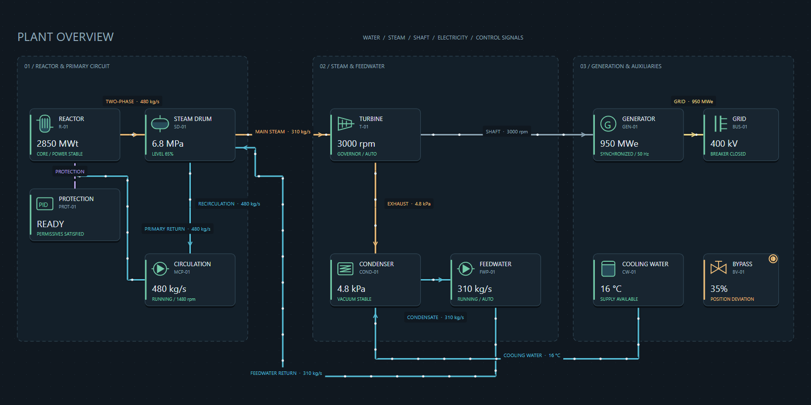

# IndustrialDiagram — architetture e sinottici di impianto

`IndustrialDiagram` è un controllo Avalonia nativo per rappresentare componenti,
connessioni, flussi, gruppi, testi e allarmi in un'unica vista navigabile.
Il riferimento visuale è il modello a nodi, gruppi e collegamenti di
[Proschi](https://github.com/gvart/proschi). L'implementazione è C# originale:
rendering vettoriale, nessun WebView e nessuna dipendenza da Proschi.



## Modello

| Tipo | Responsabilità |
| --- | --- |
| `IndustrialDiagram` | viewport, rendering, selezione, interazione, animazione |
| `DiagramDocument` | raccolte osservabili, batching e validazione della scena |
| `DiagramNode` | componente con ID stabile, posizione, simbolo, readout e stato |
| `DiagramConnection` | estremi, ancoraggi, percorso, mezzo, direzione e label |
| `DiagramGroup` | raggruppamento visuale con titolo e ingombro esplicito |
| `DiagramText` | annotazione con area e font configurabili, anche multilinea |
| `DiagramJson` | salvataggio e caricamento della scena, schema versione 1 |

Il controllo è in `IndustrialControls.Avalonia.Controls`; il modello è in
`IndustrialControls.Avalonia.Diagrams`.

## Primo esempio

```xml
<industrial:IndustrialDiagram x:Name="PlantDiagram"
    Document="{Binding PlantDocument}"
    SelectedElementId="{Binding SelectedComponentId, Mode=TwoWay}"
    ElementInvokedCommand="{Binding OpenComponentDetailsCommand}"
    MinHeight="400" />
```

```csharp
using IndustrialControls.Avalonia.Diagrams;

var document = new DiagramDocument();
using (document.BeginUpdate())
{
    document.Nodes.Add(new DiagramNode("MCP-01")
    {
        Label = "POMPA PRIMARIA",
        Symbol = DiagramSymbol.Pump,
        X = 40, Y = 100,
        ValueText = "480 kg/s",
        DetailText = "RUNNING · MEASURED",
        State = DiagramState.Active,
    });
    document.Nodes.Add(new DiagramNode("SD-01")
    {
        Label = "STEAM DRUM",
        Symbol = DiagramSymbol.SteamDrum,
        X = 400, Y = 100,
        ValueText = "6.8 MPa",
        FillFraction = 0.65,
    });
    document.Connections.Add(new DiagramConnection("primary-flow")
    {
        SourceId = "MCP-01", TargetId = "SD-01",
        Medium = DiagramMedium.Water,
        FlowDirection = DiagramFlowDirection.Forward,
        Label = "CIRCOLAZIONE", ValueText = "480 kg/s",
    });
}
PlantDiagram.Document = document;
// Dopo il layout, ad esempio nell'evento Opened dell'host:
PlantDiagram.FitToContent();
```

La geometria è in unità logiche del diagramma, prima di zoom e pan.
Gli ID sono univoci nell'intero documento e non cambiano durante gli aggiornamenti.
Le raccolte e le proprietà notificano il controllo: non serve riassegnare il
documento a ogni snapshot.

## Simboli ed estensione

Sono inclusi Equipment, Reactor, Pump, Valve, Tank, SteamDrum, HeatExchanger,
Turbine, Generator, Condenser, ElectricalBus, Sensor, Controller e Junction.
`FillFraction` è facoltativo e mostra un livello soltanto nei simboli di recipiente.
`null` non viene interpretato come recipiente vuoto.

Per simboli specifici del consumer assegnare `IndustrialDiagram.SymbolRenderer`
con un'implementazione di `IDiagramSymbolRenderer`. Il renderer riceve nodo,
`DrawingContext`, area dell'icona e brush dello stato. Restituendo `true`
sostituisce il simbolo; restituendo `false` conserva quello integrato.
`DiagramNode.SymbolKey` può identificare il simbolo custom e viene salvato nel JSON.
Il renderer personalizzato resta un oggetto dell'host e non viene serializzato.

## Connessioni e flussi

- Gli estremi sono gli ID dei nodi. `SourceAnchor` e `TargetAnchor` supportano
  Auto, Left, Top, Right e Bottom.
- `SourceOffset` e `TargetOffset`, tra 0 e 1, consentono più porte sullo stesso lato.
- Senza waypoint il percorso è ortogonale. `Waypoints` consente un percorso
  esplicito, anche per ritorni e loop. Gli incroci non creano giunzioni implicite.
- `Medium` distingue acqua, vapore, gas, elettricità, segnale, meccanica e generico.
  Il colore del mezzo resta distinto dalla gravità dell'allarme.
- `FlowDirection` controlla il movimento Forward/Reverse/None. `IsDirected`
  controlla la freccia; None ferma il movimento e conserva la freccia statica.
- `FlowSpeed` indica esclusivamente velocità grafica, in unità del diagramma/s.
  La misura fisica può essere esposta in `ValueText`, con le sue unità.
- `LabelOffsetX/Y` corregge la posizione delle etichette nei percorsi ravvicinati.
- `Unavailable` rende la linea grigia, tratteggiata e senza movimento.

Non è presente un algoritmo di aggiramento degli ostacoli: i waypoint
consentono di evitare componenti e testi in un sinottico progettato dall'host.
I gruppi definiscono aree visuali; spostarli non muove automaticamente i nodi.

## Stato esterno e allarmi

Il modello rappresenta lo stato pubblicato dall'applicazione. Non contiene
fisica, permissivi, controllo automatico o memoria locale degli allarmi.
Applicare gli snapshot sul thread UI e raggruppare le modifiche:

```csharp
using (document.BeginUpdate())
{
    var pump = document.FindNode("MCP-01")!;
    pump.ValueText = "—";
    pump.DetailText = "UNAVAILABLE · MEASURED";
    pump.State = DiagramState.Unavailable;
    pump.AlarmSeverity = DiagramAlarmSeverity.Critical;
    pump.AlarmText = "Pompa scattata";
    pump.IsAlarmAcknowledged = false;
}
```

`AlarmSeverity`, `AlarmText` e `IsAlarmAcknowledged` appartengono all'host.
Selezionare o aprire un nodo non riconosce né ripristina l'allarme. Il consumer
invia i propri comandi e applica lo snapshot risultante. Un allarme nuovo
lampeggia; un allarme riconosciuto mantiene l'indicatore fisso. Disabilitando
l'animazione gli indicatori restano visibili.

`ValueText`, `DetailText` e `Description` consentono di conservare qualità,
provenienza, unità e motivazioni del consumer. Il controllo non sostituisce
automaticamente un valore assente con zero e non deduce soglie dalle scale.

## Navigazione e interazione

| Azione | Risultato |
| --- | --- |
| Ruota | zoom centrato sul puntatore, tra 10% e 400% |
| Trascinamento dello sfondo / tasto centrale | pan |
| Click su nodo, connessione, etichetta o titolo gruppo | selezione |
| Doppio click / Invio | `ElementInvoked` e comando, se consentito |
| Frecce | selezione del nodo precedente/successivo |
| `+` / `−` | zoom sul centro |
| Home | inquadra il contenuto |
| Esc | annulla drag e selezione |
| `IsEditingEnabled = true` + drag nodo | modifica posizione del nodo |

La modalità di editing è disattivata per default. Non crea/elimina connessioni:
queste si definiscono con il modello C# o con il JSON. L'ID selezionato è bindabile;
`SelectionChanged` e `ElementInvoked` espongono l'elemento tramite event args.
Il parametro del comando è il `DiagramElement` selezionato.
`ToDiagram` e `ToViewport` convertono le coordinate; `GetConnectionRoute`
consente di ispezionare i percorsi risolti.

## Persistenza

```csharp
var json = DiagramJson.Serialize(document);
var restored = DiagramJson.Deserialize(json);
PlantDiagram.Document = restored;
```

Il JSON include geometria, route, testi e stato di presentazione; non è un
salvataggio del simulatore. Zoom, pan, comandi e renderer custom appartengono
all'host. Il formato rifiuta schema non supportato, proprietà sconosciute,
coordinate non finite, ID duplicati e riferimenti mancanti.
`document.Validate()` fornisce le anomalie anche prima del salvataggio.

## Rendering, animazioni e demo

Un solo controllo disegna la scena con `DrawingContext`, senza un albero di
controlli per ogni simbolo o particella. Le route sono memorizzate per revisione
della geometria: aggiornare readout, flussi o allarmi non le ricostruisce.
I testi hanno una cache limitata a 1.024 voci. Gli elementi fuori
viewport vengono esclusi dal disegno. Il timer è unico per diagramma, si ferma
quando il controllo è rimosso/nascosto o non c'è movimento/lampeggio, e non
avanza il tempo della simulazione.

Per rendering manuale riproducibile impostare `IsAnimationEnabled = false`
e `AnimationTime`. La demo offre la scheda iniziale ARCHITECTURE DIAGRAM,
fault/ACK sintetici, editing delle posizioni e round trip JSON.

```powershell
dotnet run --project src/IndustrialControls.Avalonia.Demo
dotnet run --project src/IndustrialControls.Avalonia.Demo -- --render-diagram diagram.png
```

La schermata di esempio è stata renderizzata e ispezionata. La qualificazione
con impianti molto grandi, prove prolungate e accessibilità assistiva completa
resta a carico del successivo lavoro di integrazione. Non sono inclusi un parser
DSL Proschi, il suo motore di simulazione o un editor grafico completo.
